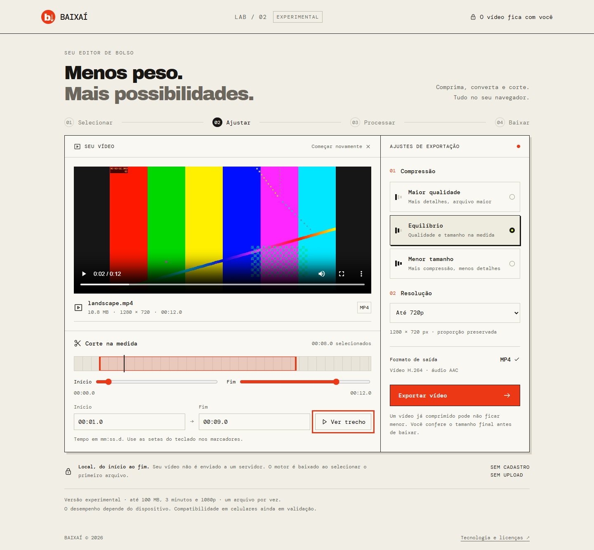

# Baixaí

**Vídeos mais leves, cortes na medida.**
Comprima, converta e corte seus vídeos com processamento local no navegador.

Versão **2.0.0-beta.1 — experimental**, em validação. Não é um downloader de YouTube: esta migração substitui URLs por arquivos locais e remove Express, `youtube-dl-exec` e o backend de processamento. O histórico anterior permanece no Git.



## O que funciona

Selecionar vídeo → ajustar → processar → baixar.

- Um arquivo MP4, MOV ou WebM por vez, desde que os codecs sejam compatíveis com o core.
- Exportação MP4 com H.264, pixel format yuv420p e AAC quando houver áudio.
- Perfis maior qualidade, equilíbrio e menor tamanho; resolução original, até 720p ou até 480p, sem ampliar vídeos menores.
- Corte com início/fim, marcadores acessíveis pelo teclado e prévia no player. Corte e compressão acontecem na mesma exportação.
- Etapas, progresso aproximado quando fornecido pelo motor, cancelamento e reinício.
- Duração, resolução e tamanho reais do arquivo final, comparação com o original e download local.

Os limites de laboratório são **100 MiB (rotulados 100 MB na interface), 3 minutos e até 1920×1080 ou 1080×1920**. São barreiras provisórias, não garantias de desempenho. Um arquivo muito comprimido pode ficar maior. A comparação de tamanho usa o arquivo original inteiro, inclusive quando há corte.

Sem lotes, GIF, extração de áudio, formatos adicionais ou busca de URLs. Legendas e metadados não são preservados; somente o primeiro vídeo e a primeira faixa de áudio são exportados. HDR, Dolby Vision, VFR complexo e cores profissionais ainda não foram validados. A prévia depende também dos codecs do navegador; um arquivo sem prévia ainda pode ser conversível.

## Rodar localmente

Requer Node.js **22.12+** e npm.

```sh
npm ci
npm run dev
```

Abra **http://127.0.0.1:4175/**. `npm start` é um alias de desenvolvimento. O motor é preparado automaticamente em `public/engine`.

```sh
npm run build
npm run preview
```

A prévia de produção roda em **http://127.0.0.1:4176/**. `dist/` contém o site estático completo; não há servidor de processamento ou variáveis secretas.

## Arquitetura e privacidade

React + TypeScript + Vite. `src/media/settings.ts` valida entradas e compõe argumentos. `src/media/engine.ts` é carregado sob demanda e usa `@ffmpeg/ffmpeg` com core **single-thread**, dentro do Worker da biblioteca. A thread da interface não executa FFmpeg.

O core ESM 0.12.10 (~31 MiB de Wasm) é copiado do npm e servido pelo próprio site, sem CDN, junto de fontes locais. A primeira seleção precisa baixar esse motor. Um novo Worker é criado por operação e terminado ao concluir, falhar ou cancelar; sua memória e filesystem virtual são descartados. URLs de blobs são revogadas ao trocar arquivos, reiniciar ou desmontar o editor. A mídia só fica na memória da aba até ser baixada pelo usuário.

Não há upload, telemetria, analytics, cookies de aplicação, armazenamento persistente ou endpoints de mídia. O teste E2E verifica os pedidos do contexto, incluindo Workers: somente GET sem corpo para a própria origem (mais URLs `blob:`). Isso não substitui revisar a configuração da hospedagem: o servidor pode registrar IP e acessos aos arquivos estáticos. Não injete scripts de terceiros ou proxies de mídia ao publicar.

O core single-thread dispensa SharedArrayBuffer/COOP/COEP. O progresso deriva do tempo codificado em relação à duração selecionada; não é uma previsão de tempo restante. Há um limite de dez minutos por operação para recuperação de travamentos. Memória disponível, bateria, aba em segundo plano e políticas do navegador podem interromper o processamento.

## Testes reproduzíveis

```sh
npm test
npm run test:fixtures
npx playwright install firefox webkit
npm run build
npm run test:e2e
```

Chrome e Edge instalados são usados pelos canais locais do Playwright. Se não estiverem instalados, execute um projeto disponível, por exemplo `npm run test:e2e -- --project=firefox`. A suíte inicia a prévia da build automaticamente. Os vídeos são padrões sintéticos gerados localmente; nenhum vídeo pessoal é necessário.

`ffmpeg-static` é **apenas dependência de desenvolvimento**: gera fixtures e decodifica as exportações independentemente para conferir validade, frames e timestamps de áudio/vídeo. Não integra o bundle nem existe um fallback de processamento em servidor. Fixtures e resultados ficam ignorados pelo Git.

## Validação e critérios de lançamento

Em 2026-10-10, o protótipo foi executado antes da interface completa em Windows, Ryzen 7 5700X, ~16 GiB RAM. Um MP4 sintético de 12 s, 1280×720, foi cortado de 1 a 3 s e reduzido para 852×480 com áudio: saída de 635.824 bytes. Tempos observados no protótipo: Chrome ~2,0 s, Edge ~2,2 s, Firefox ~3,6 s, WebKit ~2,1 s. São amostras únicas de uma máquina, não benchmarks generalizáveis ou promessas de redução.

A suíte automatizada cobre MP4/MOV/WebM, portrait sem áudio, corte, timestamps A/V, cancelamento seguido de nova exportação, liberação de Workers, arquivo corrompido, teclado, rede, tela de 390 px e texto ampliado a 200%. Os resultados finais e versões dos navegadores estão em `docs/validation.json`.

Resultado final: **7 testes unitários e 36 testes de navegador passaram** (9 cenários em cada engine). Também foi testado MOV com rotação de câmera e a semelhança dos frames do corte com o trecho original. Uma amostra adicional de 10 s em 1080p foi exportada integralmente para 720p no Chrome em ~11,2 s, de 20,0 para 5,7 MiB. Isso ainda não valida o teto de três minutos ou um celular.

**WebKit do Playwright no Windows não equivale a Safari no macOS ou iPhone.** Tela estreita não equivale a teste em celular físico. A evidência atual ainda não aprova lançamento estável nem confirma desempenho no teto proposto.

Antes de publicar para o público geral:

- [ ] Testar Safari em macOS e iPhone reais, Chrome/Firefox Android e Edge móvel; registrar aparelho, RAM, SO, versão do navegador, tempo e estabilidade.
- [ ] Medir pico de memória e desempenho com 100 MiB / 180 s / 1080p, inclusive vertical, e repetir pelo menos três operações em dispositivos modestos. Ajustar os limites conforme os resultados.
- [ ] Verificar visualmente cortes, orientação de câmera, sincronismo perceptual, codecs incompatíveis e arquivos sem áudio em mídia real autorizada. Testes de timestamps não substituem ouvir e assistir.
- [ ] Testar cancelamento em download do motor, leitura e exportação, recuperação após falta de memória, background e download nativo em iOS.
- [ ] Revisar GPL, fontes correspondentes e codecs da distribuição, conforme `THIRD_PARTY_NOTICES.txt`.
- [ ] Publicar a build validada e repetir a inspeção de rede na URL final.
- [ ] Adicionar ao portfólio após aprovação, usando `docs/portfolio.txt` e a prévia do editor. O destino do portfólio ainda precisa ser indicado.

## Hospedagem estática (após validação)

Comando de build: `npm ci && npm run build`. Diretório de publicação: `dist`. É necessário instalar também as dependências de desenvolvimento durante o build, pois ali está o core. O host precisa aceitar o arquivo `.wasm` de ~31 MiB, servi-lo como `application/wasm` e servir Workers JS da mesma origem, idealmente por HTTPS. Alguns planos impõem limites por arquivo: confira antes de escolher a hospedagem.

Não publicar `node_modules`, `.fixtures`, `test-results`, `.tools` ou arquivos pessoais. Não usar `vite preview` como servidor público de produção. Esta versão foi configurada para a raiz do domínio; implantação em subpasta precisa ajustar o `base` do Vite e validar novamente as URLs de assets.

## Licenças

Leia [os avisos](THIRD_PARTY_NOTICES.txt) e a página local `/licenses.html`. O wrapper FFmpeg.wasm é MIT; o **core usado é GPL-2.0-or-later**, não MIT. O [Dockerfile da release](https://github.com/ffmpegwasm/ffmpeg.wasm/blob/v12.15/Dockerfile) habilita GPL e inclui x264/x265, entre outras bibliotecas. Antes da redistribuição pública, completar a entrega de fontes correspondentes, receita de build e licenças aplicáveis; as referências mutáveis do upstream ainda exigem conferência.

Referências: [FFmpeg.wasm](https://ffmpegwasm.netlify.app/docs/overview/), [limitações e licenças](https://ffmpegwasm.netlify.app/docs/faq/), [FFmpeg — considerações legais](https://ffmpeg.org/legal.html). Nenhuma nova licença foi atribuída ao código original do proprietário nesta migração.
